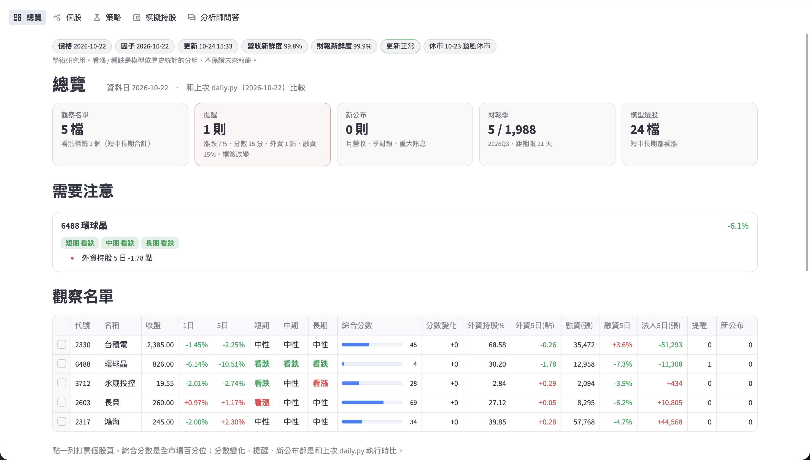
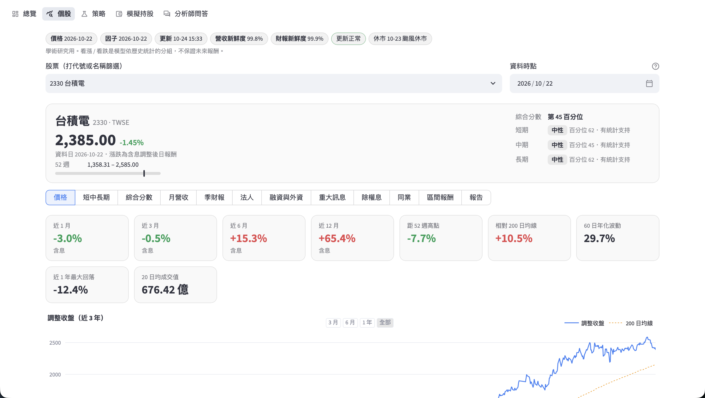
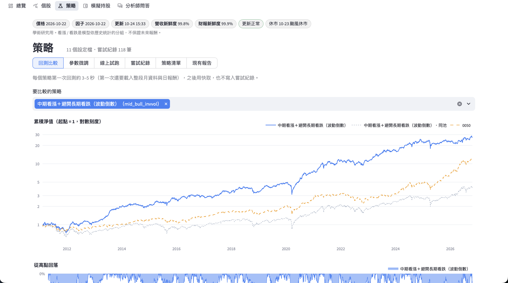

# 台股量化研究

台股（上市、上櫃）的量化研究系統，學術研究用途。從月營收、財報、價格、籌碼資料算出因子，做月頻選股與策略回測，並提供本機前端和可用自然語言提問的分析師。

## 功能

**資料更新與檢查**
- `update.py` 一次完成：抓行情、籌碼、財報快照、重大訊息，重建資料表與因子，再做健康檢查（最新交易日、資料列數有沒有變少、近 30 日可疑報酬、月營收與財報覆蓋率），結果寫進 `data/update_status.json`。
- 用財報與營收的「公布日」對齊資料，換股日只用當時已公布的資訊，避免偷看未來。
- 股價用除權息、減資、變更面額、ETF 分割事件還原。

**因子與選股訊號**
- 月頻因子表，加上單因子回測：rank IC 和五分位投組，可做產業與市值中性化。
- 綜合分數：把營收動能、品質、價值、趨勢四組因子合成，並分樣本內（2011–2018）與樣本外（2019 起）檢驗。
- 短、中、長期看漲／中性／看跌標籤，每個標籤附歷史校準（百分位與樣本外表現）。
- 量化護城河：用過去 10 年的 ROE 與毛利率穩定度，分成 Wide / Narrow / None。
- 仿晨星星等：護城河加不確定性與公允價值（剩餘收益模型），給 1–5 星並回測。
- 技術面訊號與大盤多空判斷、市場狀態指標。

**策略回測**
- 策略用 `strategies/*.toml` 設定：選股（排序、檔數、篩選）、持股權重（上限、產業上限、最小交易單位）、風控（大盤濾網、目標波動、停損、回落限制）、交易成本、訊號延遲。目前附 11 個範例策略。
- 用真實資金模擬月頻換股，和同池等權、0050 比較；報告有累積淨值、回落、各期間年化報酬、波動、Sharpe、換手率與成本。
- 穩健性檢查：參數微調（每個策略 9–12 個變體）、分段績效、相對 0050 的超額報酬與 t 值。
- 策略檔寫的 `lag`（訊號日後第幾個交易日成交）現在會生效；以前 `load_config` 只保留預設欄位，寫了也照 1 天算。沒寫 `lag` 的策略結果與設定雜湊都不變。
- 單檔上限和產業上限輪流套用到兩個都滿足；以前先套單檔再套產業，產業多出的權重會讓個股超過單檔上限（`mid_bull_invvol` 190 個月裡有 17 個月超過 20%，最高 28%）。修正後該策略全期年化 24.0% → 24.2%，其他策略不受影響。
- 下市：最後一筆行情離資料尾端 30 天以上的股票視為下市，持股在下一個換股日按最後價值轉成現金（以前會一直卡在帳上賣不掉）；下市當下的報酬用 `strategy.DELIST_RET` 設定，預設 0。現有 11 個策略都沒有在下市時還持有股票，改成 −100% 也只影響用等權大盤當濾網的 3 個策略（因為等權指數本身變了，年化差 −0.7～+2.0 個百分點）。
- 每次回測都寫入嘗試紀錄（`data/strategy/trials.jsonl`），誠實記下試過幾個設定。
- `diagnose.py` 拆解綜合分數 Top-N 輸給同池等權的原因：產業配置、市值、哪一組因子拖累。
- `event_study.py` 事件研究：月營收公告後 5／20／60 個交易日，相對同期流動股票池的超額報酬（扣成本、以月份分群算 t 值），另看外資買賣超條件，並換成市值×波動配對、同產業、0050 三種基準比較（`data/event_study_bench.csv`）。目前最強的是「單月營收創歷史新高且年增 ≥30%」：60 日平均超額對流動股池約 5.4%、對市值×波動配對約 4.2%、對產業約 3.6%，2013–2018 與 2019 後都成立；但勝率不到一半，而 2024 起對 0050 的超額不顯著（t 約 1.2）。

**模擬持股**
- 每月記下綜合分數前 30 名（20 日均成交值 2,000 萬以上），訊號日隔天收盤進場、等權、扣成本，之後追蹤實際報酬，累積真正的樣本外紀錄。
- 另可在 `paper_strategies.txt` 列多個策略，各自追蹤目標曝險、持股與大盤濾網狀態。

**LLM 決策模擬（虛擬資金）**
- `llm_trader.py`：量化規則給候選（營收創新高且年增 ≥30%、20 日均成交值 5,000 萬以上），Claude 讀個股事實表後決定買／不買／等待，附信心、理由與風險；等待的股票之後重評，第一次決策後超過 20 個交易日就放棄。
- 同時跑三組模擬持股，持有 60 個交易日、等權，和 0050 比較：LLM 篩選、量化全買（不經 LLM）、隨機對照（每批隨機挑和 LLM 一樣多檔）。只有 LLM 組穩定贏過另外兩組，才代表 LLM 有加分。成交在決策之後的第一個交易日，不回填。
- `status` 另做選股檢定：LLM 買進的平均報酬，對照每批隨機挑同樣檔數重複 1,000 次的分布，看落在第幾百分位。
- 決策寫進 `data/paper/llm_decisions.jsonl`，只追加不改，含模型、prompt 雜湊、token 數與費用；模型看到的輸入原文另存在 `data/paper/llm_inputs/`，之後可以重建當時的判斷依據。
- 模型知識截止在 2026-06，更早的日期可能記得後來的股價，所以只能從現在往後累積證據；`try --asof` 只用來除錯。
- `llm_replay.py` 準前瞻回放：拿知識截止之後的 2026-07～09 三批事件，用當時的事實表重跑同一套決策（wait 在第 10、20 個交易日重問），再比 LLM buy、全部候選、每批隨機挑同樣檔數 1,000 次的 20 日與 60 日報酬。紀錄寫在 `data/paper/llm_replay.jsonl`，和前向的決策分開。

**每日速覽與個股報告**
- 觀察名單（`watchlist.txt`）每日比對上次結果，超過門檻就提醒：單日漲跌超過 7%、綜合分數變動 15 分以上、外資持股 5 日變動 1 點以上、融資 5 日變動 15% 以上、看漲看跌標籤改變。同時列出新公布的月營收、季財報與重大訊息。
- `report.py` 產生個股 HTML 報告：價格、評分、營收、財報、法人、重大訊息、除權息。可用 `--asof` 回到過去某天，只用當時已公布的資料。可選擇用 Claude 寫文字摘要，`--no-llm` 則不呼叫。

**前端與分析師問答**
- 本機 Streamlit 前端：總覽、個股、策略、模擬持股、分析師問答五頁，頁首固定顯示資料日期與新鮮度。
- 分析師問答讓 Claude 呼叫工具查專案資料回答問題，例如「台積電最近一季毛利率和去年同季比如何？」。可選 Sonnet 或 Haiku，每則先估花費、回答後顯示實際花費，對話寫進 `logs/analyst/`。`evals/analyst/` 有評測題，分成開發集（`cases.jsonl`，27 題，改 prompt 時都看過）和保留集（`holdout.jsonl`，18 題，同類別不同股票，沒拿來調 prompt）。平常只跑開發集；保留集要加 `--split holdout`，每個 prompt 加模型只能跑一次，每次執行記在 `evals/analyst/holdout_runs.jsonl`。

> 輸出的選股清單、星等與看漲看跌標籤是依歷史統計的分組，不保證未來報酬，不構成投資建議。

## 畫面

本機 Streamlit 前端。

**總覽**：觀察名單、需要注意的變化、模型選股。



**個股**：價格、短中長期標籤、綜合分數、月營收、季財報、法人、重大訊息等分頁。



**策略**：策略回測與 0050、同池等權比較，另有參數微調、線上試跑、嘗試紀錄。



## 需求

- Python 3.11 以上，用 [uv](https://docs.astral.sh/uv/) 執行。各腳本開頭已宣告依賴，`uv run` 會自動安裝，不必另建環境。
- 資料不在 repo 裡（`data/` 被 `.gitignore` 排除），需要另外取得，見下節。
- 只有分析師問答需要 Anthropic API key，其他功能不需要。

## 資料

所有資料放在 `data/` 底下，程式用相對路徑讀取：

| 位置 | 內容 | 來源 |
|---|---|---|
| `data/prices/{twse,tpex}/` | 每日全市場收盤行情 | 證交所、櫃買中心，`fetch_prices.py` |
| `data/tej/` | 月營收、季財報的 TEJ 匯出 CSV | TEJ（授權資料，需自備） |
| `data/raw/` | 現金流、三大法人、融資融券、外資持股、除權息、重大訊息、OpenAPI 快照 | 證交所、櫃買、公開資訊觀測站，各 `fetch_*.py` |
| `data/*.parquet`、`data/*.json` | 上述資料整理後的分析用表 | 由腳本產生 |

拿到資料包的話，照資料包裡的 README 解壓到上述位置即可。沒有資料包也可以自己從頭抓：

```bash
uv run fetch_prices.py --market twse && uv run fetch_prices.py --market tpex
uv run fetch_events.py --source twse && uv run fetch_events.py --source tpex
uv run fetch_chips.py --market twse && uv run fetch_chips.py --market tpex
uv run fetch_public.py
```

行情和籌碼從 2010 年抓起要好幾個小時，交易所會封鎖太頻繁的請求，腳本已內建間隔，被擋時等一陣子重跑會從中斷處接續。**TEJ 的月營收與財報沒有公開來源，要自己有授權並把匯出檔放進 `data/tej/`**；沒有的話，只能用證交所／櫃買 OpenAPI 快照累積的最新資料，歷史會很短。

## 快速開始

資料放好後，在專案根目錄依序執行：

```bash
uv run build_prices.py             # 行情 + 除權息事件 → 還原股價（要最先跑）
uv run fetch_chips.py --build      # 籌碼原始檔 → 三大法人、融資融券、外資持股表
uv run fetch_mops.py --parse-only  # 重大訊息原始頁面 → announcements.parquet
uv run fetch_cashflow.py --parse-only
uv run update.py --skip-fetch      # 不抓新資料，依序重建：行情 → 面板 → 因子 → 綜合分數 → 標籤 → 模擬持股 → 每日速覽
```

可選：`uv run moat.py` 與 `uv run stars.py` 產生護城河分級與星等的資料表。

之後每天更新資料並重算全部結果：

```bash
uv run update.py               # 抓新資料 → 重建 → 健康檢查 → 模擬持股 → 每日速覽
uv run update.py --skip-fetch  # 只重建與檢查
```

啟動前端（含 TEJ 數字，只綁本機）：

```bash
uv run --with-requirements frontend/requirements.txt streamlit run frontend/app.py --server.address 127.0.0.1
```

瀏覽器開 `http://127.0.0.1:8501`。頁面有總覽、個股、策略、模擬持股、分析師問答，說明見 [docs/frontend.md](docs/frontend.md)。

## 腳本一覽

| 腳本 | 用途 |
|---|---|
| `fetch_prices.py`、`fetch_events.py`、`fetch_chips.py`、`fetch_public.py`、`fetch_cashflow.py`、`fetch_mops.py` | 下載各類原始資料 |
| `build_panel.py`、`build_prices.py`、`public_data.py` | 整理成 parquet；OpenAPI 快照補 TEJ 之後的新資料 |
| `factors.py` | 月頻因子表（只用當時已公布的資料，避免偷看未來） |
| `backtest.py` | 單因子 rank IC 與五分位回測 |
| `composite.py` | 四組因子合成綜合分數，樣本內／外回測 |
| `moat.py`、`stars.py`、`outlook.py` | 護城河分級、星等、看漲看跌標籤 |
| `technicals.py`、`regime.py` | 技術面訊號與大盤多空、市場狀態指標 |
| `patterns.py`、`refprice.py`、`matrix.py` | 價格形態、參考價（支撐壓力、停損、統計區間）、四維訊號矩陣，各附歷史校準；只進報告與個股頁 |
| `strategy.py`、`robust.py`、`strategies/*.toml` | 策略回測與穩健性檢查，策略以 TOML 設定 |
| `paper.py` | 模擬持股，每月記錄前 N 名並追蹤報酬 |
| `mine.py` | 自選股即時模擬：自己挑股票，從最新資料日起往後記錄並追蹤（可月調） |
| `custom.py` | 自選股模擬：自己挑股票、權重和起訖日回頭重播，對比 0050 |
| `diagnose.py` | 拆解綜合分數輸給同池等權的原因 |
| `event_study.py` | 月營收與外資事件研究，輸出 `data/event_study.csv` |
| `llm_replay.py` | LLM 決策的準前瞻回放：`run --dry-run` 估費用、`run` 回放 2026-07～09、`report` 選股檢定 |
| `llm_trader.py` | LLM 決策模擬：`candidates` 列候選、`run --dry-run` 估費用、`run` 決策並更新三組持股、`status` 看績效 |
| `report.py`、`daily.py` | 個股報告、每日速覽，輸出到 `reports/` |
| `analyst.py`、`evals/analyst/` | 分析師問答（命令列）與評測題組 |
| `update.py` | 每日更新的總流程 |

各腳本開頭的說明文字有完整用法，例如 `uv run strategy.py strategies/top30.toml`。

## 測試與 CI

`tests/` 用合成行情測回測的核心邏輯（設定檔、權重上限、報酬清理、成交與成本），不需要 `data/`。每次推送和開 PR，GitHub Actions（`.github/workflows/ci.yml`）會跑 ruff 的語法檢查和這些測試。本機執行：

```bash
uv run --isolated --no-project --with pytest --with pandas --with numpy --with pyarrow pytest tests -q
```

## 分析師問答與費用

`analyst.py`、`report.py`、`llm_trader.py` 與前端的問答頁會呼叫 Anthropic API，**會產生費用**。在專案根目錄建立 `.env`：

```
ANTHROPIC_API_KEY=你的key
```

個股報告預設用較便宜的模型，問答預設用 Sonnet，可用 `--model haiku` 改。`llm_trader.py` 預設用 Haiku，每檔約 1 萬輸入 token，120 檔約 US$0.25；先用 `run --dry-run` 看估價。`.env` 已在 `.gitignore`，不會被提交。

## 使用限制

- TEJ 資料有授權限制，不得轉傳或公開，所以前端只能在本機執行，不要部署到公開網址。
- `reports/` 的 HTML 可能含 TEJ 數字，分享前請先確認。
- 證交所、櫃買、公開資訊觀測站的資料請依其使用條款取用，不要提高請求頻率。
